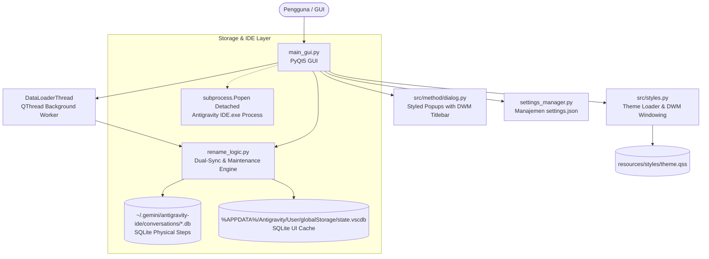

# System Architecture - Antigravity Conversation Renamer

Dokumen ini memaparkan secara komprehensif arsitektur teknis, diagram komponen, pipeline data, dan alur eksekusi pada aplikasi **Antigravity Conversation Renamer**.

---

## 1. Arsitektur Komponen Tingkat Tinggi

Aplikasi ini dibangun menggunakan arsitektur modular berbasis Python, PyQt5, dan SQLite/Protobuf storage engine:



---

## 2. Struktur Modul & Tanggung Jawab

| File / Modul | Peran & Tanggung Jawab |
| :--- | :--- |
| [`run.py`](../run.py) | **Titik Masuk Utama (Root Entry Point):**<br/>- Menyiapkan environment `sys.path` dan memanggil `src.main_gui.main()`. |
| [`src/main_gui.py`](../src/main_gui.py) | **Antarmuka Pengguna & Windowing:**<br/>- Menampilkan antarmuka PyQt5 bertema *Ocean Dark* (meniru standar ADR Prompt Manager).<br/>- Mengintegrasikan Windows DWM API (`dwmapi.dll`) untuk title bar native gelap tanpa bug kursor/border.<br/>- Menjalankan background threading (`DataLoaderThread`) agar UI tidak freeze saat parsing SQLite/Protobuf.<br/>- Menangani lifecycle reload Antigravity IDE secara aman via `subprocess.Popen` (detached). |
| [`src/method/dialog.py`](../src/method/dialog.py) | **Dialog & Pesan Terstandarisasi:**<br/>- Menyediakan helper dialog pop-up (`show_info`, `show_warning`, `show_critical`, `show_question`) dengan dekorasi Windows DWM title bar gelap terstandarisasi. |
| [`src/rename_logic.py`](../src/rename_logic.py) | **Mesin Inti Dual-Sync & Maintenance:**<br/>- Membaca dan mem-parsing database percakapan fisik (`.db`).<br/>- Mengubah judul pada payload Protobuf dalam SQLite `steps` (`update_db_title`).<br/>- Memperbarui atau melakukan **UPSERT** pada cache sidebar `state.vscdb` (`update_global_storage_title`).<br/>- Memindai dan membasmi entri zombie/hantu (`clean_zombie_conversations`).<br/>- Memulihkan dan menyinkronkan seluruh percakapan disk ke sidebar (`sync_all_active_conversations_to_sidebar`). |
| [`src/settings_manager.py`](../src/settings_manager.py) | **Konfigurasi Lokal Dinamis:**<br/>- Menyimpan dan memuat path executable Antigravity IDE.<br/>- Melakukan fallback otomatis ke path default di `%LOCALAPPDATA%` / `~/AppData/Local/Programs/Antigravity IDE/Antigravity IDE.exe`. |
| [`src/styles.py`](../src/styles.py) | **Mesin Tema & Windowing DWM:**<br/>- Loader stylesheet QSS (`load_theme_qss`) dengan deteksi multi-tier (frozen bundle, resources, fallback).<br/>- Integrasi Windows DWM API (`apply_dark_window_titlebar`) untuk pewarnaan title bar native. |
| [`resources/styles/theme.qss`](../resources/styles/theme.qss) | **Stylesheet Terpisah (QSS):**<br/>- Seluruh styling tema Ocean Dark terisolasi dalam format CSS/QSS murni. |

---

## 3. Pipeline Data: Dual-Sync Storage Engine

Antigravity IDE mengadopsi mekanisme penyimpanan ganda (*two-tier storage architecture*). Kegagalan melakukan pembaruan di salah satu sisi akan mengakibatkan inkonsistensi data:

```mermaid
sequenceDiagram
    autonumber
    actor User as Pengguna
    participant UI as GUI (MainApp)
    participant Logic as rename_logic
    participant ConvDB as Conv DB (*.db)
    participant VscDB as UI Cache (state.vscdb)
    participant IDE as Antigravity IDE

    User->>UI: Klik Rename ("Judul Baru")
    UI->>Logic: rename_conversation_by_id(conv_id, new_title)
    
    rect rgb(23, 37, 84)
        Note over Logic,ConvDB: Tahap 1: Sinkronisasi Database Fisik
        Logic->>ConvDB: Backup ke <conv_id>.db.bak
        Logic->>ConvDB: PRAGMA wal_checkpoint(FULL)
        Logic->>ConvDB: Decode steps Protobuf (Field 30 -> Subfield 4)
        Logic->>ConvDB: Encode & Update step_payload
        Logic->>ConvDB: PRAGMA wal_checkpoint(FULL)
    end

    rect rgb(30, 58, 138)
        Note over Logic,VscDB: Tahap 2: Sinkronisasi UI Sidebar (UPSERT)
        Logic->>VscDB: Backup ke state.vscdb.bak
        Logic->>VscDB: Query ItemTable (key: antigravityUnifiedStateSync.trajectorySummaries)
        Logic->>VscDB: Base64 Decode & Decode Protobuf (Field 1)
        alt ID Ditemukan
            Logic->>VscDB: Update inner title (Inner Field 1) + Timestamps
        else ID Belum Ada (Baru)
            Logic->>VscDB: UPSERT: Sisipkan new_item di index 0
        end
        Logic->>VscDB: Encode Protobuf -> Base64 Encode -> UPDATE ItemTable
        Logic->>VscDB: PRAGMA wal_checkpoint(FULL)
    end

    Logic-->>UI: Return Success
    UI->>User: Dialog Konfirmasi Reload IDE
    opt User memilih "Ya"
        UI->>IDE: taskkill /F /IM "Antigravity IDE.exe" /T
        UI->>UI: QTimer.singleShot(2000ms delay)
        UI->>IDE: subprocess.Popen(agi_path, DETACHED_PROCESS, DEVNULL)
    end
```



---

## 4. Struktur Wire Format Protobuf

### A. Database Fisik (`<conv_id>.db`)
Tabel `steps`, kolom `step_payload` (tipe `BLOB`):
* Payload terbungkus sebagai struktur Protobuf:
  * Field `30`: Objek metadata langkah percakapan (*turn message metadata*).
    * Subfield `4`: String UTF-8 judul percakapan. Sering kali berbentuk string tunggal atau format `Title\n\nInitial Summary`.
    * Fungsi `update_db_title()` memisahkan judul lama dan mempertahankan summary bagian bawah bila ada (`parts[1]`).

### B. UI Cache Sidebar (`state.vscdb`)
Tabel `ItemTable`, kolom `value` untuk kunci `antigravityUnifiedStateSync.trajectorySummaries`:
* Data disimpan sebagai string Base64 dari Protobuf root:
  * Field `1` (`repeated message`): Daftar percakapan aktif di sidebar:
    * Tag `1` (`bytes`): String UUID / `conversation_id`.
    * Tag `2` (`message`):
      * Subfield `1` (`bytes`): String Base64 dari **inner protobuf message**:
        * Inner Tag `1` (`bytes`): String UTF-8 judul percakapan.
        * Inner Tag `3` (`message`): Unix timestamp waktu dibuat/diubah (`int`).
        * Inner Tag `7` (`message`): Unix timestamp (`int`).
        * Inner Tag `10` (`message`): Unix timestamp (`int`).

---

## 5. Mekanisme Keandalan & Self-Healing

1. **Auto-Backup Sebelum Write (`.bak`):**
   Setiap operasi tulis ke database SQLite (`.db` maupun `state.vscdb`) selalu didahului oleh penyalinan file ke ekstensi `.bak` via `shutil.copy2`.
2. **SQLite WAL Flusing:**
   Eksekusi `PRAGMA wal_checkpoint(FULL)` dipanggil sebelum dan sesudah mutasi untuk memastikan Write-Ahead Log (WAL) langsung diterapkan ke file database utama.
3. **Pembersihan Zombie/Hantu (`clean_zombie_conversations`):**
   Mendeteksi entri di sidebar yang file fisiknya sudah dihapus oleh pengguna. Fungsi ini membuang entri tersebut dari `trajectorySummaries` agar daftar percakapan sidebar tetap bersih.
4. **Auto-Recovery Percakapan Aktif (`sync_all_active_conversations_to_sidebar`):**
   Dijalankan di thread latar belakang saat inisialisasi aplikasi. Jika ada file percakapan fisik di disk yang hilang dari cache sidebar, fungsi ini otomatis menyisipkannya kembali ke dalam `state.vscdb`.

---

## 6. Windows Non-Blocking Process Reloader

Untuk menerapkan judul baru ke antarmuka Antigravity IDE, proses IDE harus dimatikan dan dibuka kembali:

1. **Penghentian Proses:**
   ```python
   subprocess.run('taskkill /F /IM "Antigravity IDE.exe" /T', shell=True, stdout=subprocess.DEVNULL, stderr=subprocess.DEVNULL)
   ```
2. **Jeda Asinkron (Non-Blocking):**
   Menggunakan `QTimer.singleShot(2000, callback)` untuk memberi waktu OS melepas mutex dan handle file SQLite tanpa membuat window GUI utama macet (*Not Responding*).
3. **Peluncuran Mandiri (Detached Spawn):**
   ```python
   DETACHED_PROCESS = 0x00000008
   CREATE_NEW_PROCESS_GROUP = 0x00000200
   subprocess.Popen(
       [agi_path],
       creationflags=DETACHED_PROCESS | CREATE_NEW_PROCESS_GROUP,
       close_fds=True,
       stdout=subprocess.DEVNULL,
       stderr=subprocess.DEVNULL,
       stdin=subprocess.DEVNULL
   )
   ```
   > [!IMPORTANT]
   > Parameter `DEVNULL` dan `DETACHED_PROCESS` mencegah konsol CMD pengembang tertahan oleh log internal Electron Antigravity IDE.
