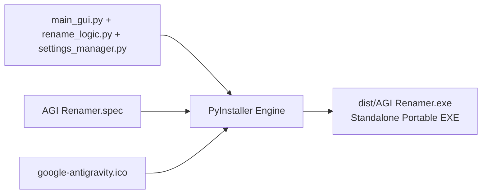

# Build System & Packaging Guide - Antigravity Conversation Renamer

Dokumen ini menjelaskan alur kompilasi (*build process*), bundling aset biner mandiri (*standalone executable*), serta konfigurasi PyInstaller untuk aplikasi **Antigravity Conversation Renamer**.

---

## 1. Ikhtisar Build System

Aplikasi ini didistribusikan sebagai file biner Windows mandiri (`AGI Renamer.exe`) tanpa mewajibkan pengguna menginstal Python atau pustaka eksternal:



---

## 2. Struktur Konfigurasi: `AGI Renamer.spec`

File spesifikasi utama berada di root proyek: [`AGI Renamer.spec`](../AGI%20Renamer.spec).

### Poin-Poin Konfigurasi Krusial:
1. **Hidden Imports:**
   ```python
   hiddenimports=['blackboxprotobuf', 'blackboxprotobuf.lib', 'blackboxprotobuf.lib.types']
   ```
   > [!IMPORTANT]
   > Pustaka `blackboxprotobuf` memuat modul tipe secara dinamis saat runtime (*dynamic introspection*). Tanpa mendaftarkan `hiddenimports` ini, PyInstaller tidak akan menyertakan serializer tipe Protobuf ke dalam bundle, sehingga aplikasi akan crash saat membaca payload database.

2. **Aset Data & Ikon:**
   ```python
   datas=[('google-antigravity.ico', '.')]
   icon=['google-antigravity.ico']
   ```
   Menyematkan file ikon aplikasi ke dalam root runtime virtual (`sys._MEIPASS`) dan menanamkannya ke dalam resource header binary Windows.

3. **Windowed Mode (Tanpa Jendela Konsol Hitam):**
   ```python
   console=False
   ```
   Menonaktifkan jendela hitam konsol terminal Windows (CMD), sehingga saat aplikasi `.exe` dibuka hanya jendela GUI PyQt5 yang muncul.

---

## 3. Resolusi Path Ikon saat Runtime (`sys._MEIPASS`)

Di dalam kode [`main_gui.py`](../main_gui.py), penanganan path ikon dirancang adaptif antara mode development skrip dan mode binary compiled:

```python
icon_path = os.path.join(os.path.dirname(os.path.abspath(__file__)), "google-antigravity.ico")
if getattr(sys, 'frozen', False):
    # Dijalankan sebagai standalone binary hasil kompilasi PyInstaller
    icon_path = os.path.join(sys._MEIPASS, "google-antigravity.ico")
```

---

## 4. Skrip Otomasi Kompilasi (`Create Installer.cmd`)

Untuk membangun binary mandiri, cukup jalankan skrip batch:
[`Create Installer.cmd`](../Create%20Installer.cmd)

Isi skrip:
```cmd
@echo off
echo Membangun AGI Renamer...
.\.venv\Scripts\pyinstaller.exe "AGI Renamer.spec"
echo Selesai!
```

### Hasil Build:
* File biner akan dihasilkan di: `dist/AGI Renamer.exe`
* Direktori `build/` dan file biner di `dist/` **terisolasi di `.gitignore`** agar tidak mengotori repositori Git.
