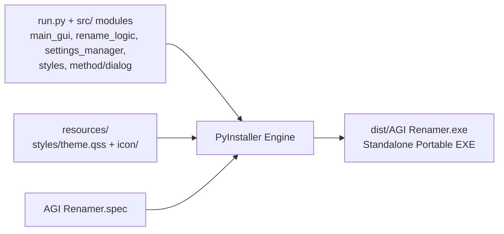

# Build System & Packaging Guide - Antigravity Conversation Renamer

Dokumen ini menjelaskan alur kompilasi (*build process*), bundling aset biner mandiri (*standalone executable*), serta konfigurasi PyInstaller untuk aplikasi **Antigravity Conversation Renamer**.

---

## 1. Ikhtisar Build System

Aplikasi ini didistribusikan sebagai file biner Windows mandiri (`AGI Renamer.exe`) tanpa mewajibkan pengguna menginstal Python atau pustaka eksternal:



---

## 2. Struktur Konfigurasi: `AGI Renamer.spec`

File spesifikasi utama berada di root proyek: [`AGI Renamer.spec`](../AGI%20Renamer.spec).

### Poin-Poin Konfigurasi Krusial:
1. **Hidden Imports:**
   ```python
   hiddenimports=['blackboxprotobuf', 'blackboxprotobuf.lib', 'blackboxprotobuf.lib.types']
   ```
   > [!IMPORTANT]
   > Pustaka `blackboxprotobuf` memuat modul tipe secara dinamis saat runtime (*dynamic introspection*). Tanpa mendaftarkan `hiddenimports` ini, PyInstaller tidak akan menyertakan serializer tipe Protobuf ke dalam bundle, sehingga aplikasi akan crash saat membaca payload database.

2. **Aset Data & Ikon:**
   ```python
   datas=[('resources', 'resources')]
   icon=['resources/icon/google-antigravity.ico']
   ```
   Menyematkan seluruh direktori `resources/` (berisi file tema `resources/styles/theme.qss` dan ikon `resources/icon/`) ke dalam bundle runtime virtual (`sys._MEIPASS`) dan menanamkan ikon aplikasi ke dalam resource header biner Windows.

3. **Windowed Mode (Tanpa Jendela Konsol Hitam):**
   ```python
   console=False
   ```
   Menonaktifkan jendela hitam konsol terminal Windows (CMD), sehingga saat aplikasi `.exe` dibuka hanya jendela GUI PyQt5 yang muncul.

---

## 3. Resolusi Path Ikon & Aset saat Runtime (`sys._MEIPASS`)

Di dalam kode [`src/main_gui.py`](../src/main_gui.py) dan [`src/styles.py`](../src/styles.py), penanganan path dirancang adaptif multi-tier antara mode development skrip dan mode binary compiled PyInstaller:

```python
def get_app_icon_path() -> str:
    """Mencari google-antigravity.ico di frozen bundle, resources/icon, parent root, dan current dir."""
    if getattr(sys, 'frozen', False):
        p_res = os.path.join(sys._MEIPASS, "resources", "icon", "google-antigravity.ico")
        if os.path.exists(p_res):
            return p_res
        p_root = os.path.join(sys._MEIPASS, "google-antigravity.ico")
        if os.path.exists(p_root):
            return p_root

    candidates = [
        os.path.join(os.path.dirname(os.path.dirname(os.path.abspath(__file__))), "resources", "icon", "google-antigravity.ico"),
        os.path.join(os.path.dirname(os.path.abspath(__file__)), "resources", "icon", "google-antigravity.ico"),
        os.path.join("resources", "icon", "google-antigravity.ico"),
        # Fallback root path
        "google-antigravity.ico"
    ]
    for c in candidates:
        if os.path.exists(c):
            return c
    return ""
```

---

## 4. Skrip Otomasi Kompilasi (`Create Installer.cmd`)

Untuk membangun binary mandiri, cukup jalankan skrip batch:
[`Create Installer.cmd`](../Create%20Installer.cmd)

Isi skrip:
```cmd
@echo off
echo Membangun AGI Renamer...
.\.venv\Scripts\pyinstaller.exe "AGI Renamer.spec"
echo Selesai!
```

### Hasil Build:
* File biner akan dihasilkan di: `dist/AGI Renamer.exe`
* Direktori `build/` dan file biner di `dist/` **terisolasi di `.gitignore`** agar tidak mengotori repositori Git.
